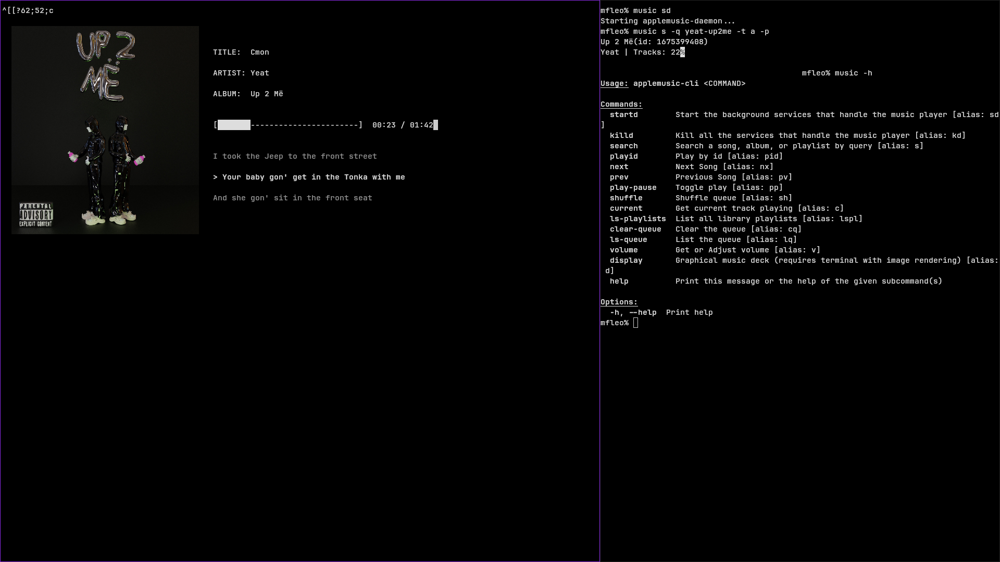

# applemusic-cli

A lightweight, high-performance Rust command-line client and daemon for Apple Music on Linux. 

`applemusic-cli` bypasses the slow, heavy browser UI by interacting directly with the **MusicKit V3 API** through a headless Firefox background instance. This approach completely circumvents DRM constraints while stripping away browser overhead and eliminating long event pipelines for instant command response times.

---

<p align="center">
  
</p>

---

## Key Features

* **Headless Firefox Backend:** Resolves Apple Music DRM restrictions natively using a minimal browser instance running in the background.
* **Direct MusicKit V3 API Integration:** Skips bloated web UI rendering and complex click pipelines, delivering snappy, low-latency playback control.
* **Terminal Display Mode:** Real-time terminal interface rendering cover art (for supported terminal emulators like Kitty or Sixel) alongside synced, scrolling lyrics.
* **LRCLIB Integration:** Synced lyrics fetched automatically from [lrclib.net](https://lrclib.net).
* **Ultra-Low Resource Footprint:**
  * **Rust TUI / CLI:** ~0% CPU usage and ~2% RAM on standard hardware (~32GB DDR4 / Ryzen 5 5600X).
  * **Daemon Overhead:** Skips all UI rendering, using barely ~0.2% RAM (~65MB).
* **Window Manager Friendly:** Designed to be effortlessly bound to keyboard shortcuts in `i3wm`, `sway`, `hyprland`, `bspwm`, or `xbindkeys`.
* **Full Music Control:** Search, queue manipulation, volume adjustment, track navigation, and real-time playback monitoring.

---

## OS & Platform Support

* **Primary Target:** Developed, optimized, and exclusively tested on **Linux** (Arch Linux / `i3wm`).
* **Other Platforms:** While Rust and Firefox are cross-platform, Linux is the main supported environment. Issues on non-Linux platforms may not be actively addressed.
* **Maintenance Status:** The project is actively maintained with bug fixes, optimizations, and new feature updates planned for future releases.

---

## Requirements

* **Firefox** (installed on your system).
* **Rust Compiler & Cargo** (only if building from source).
* **Image-capable terminal emulator** (optional, required only for terminal cover art rendering, e.g., Kitty, WezTerm, Konsole).

---

## Installation

### Option 1: Precompiled Binary
Download the precompiled binary directly from the release folder inside the repository:
```bash
cp target/release/applemusic-cli /usr/local/bin/
